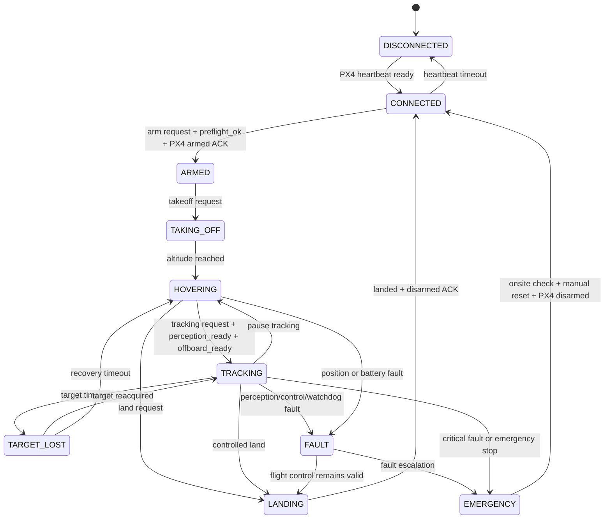

# PX4研究地面站安全状态机设计

## 1. 安全边界

状态机运行在ROS 2安全监督节点，不运行在浏览器。Web页面关闭、FastAPI重启或数据库不可用都不能中断PX4本地保护和已触发的安全动作。

基础框架中的FastAPI模拟状态机用于接口开发，不可作为实机飞行安全组件。实机状态转换必须由PX4遥测和命令ACK确认，不能在HTTP返回后立即推断完成。

## 2. 状态

| 状态 | 含义 |
|---|---|
| `DISCONNECTED` | 未发现PX4心跳或DDS状态 |
| `CONNECTED` | 已连接，未解锁 |
| `ARMED` | 已解锁，尚未起飞 |
| `TAKING_OFF` | 正在上升到安全高度 |
| `HOVERING` | 定点悬停，可等待任务 |
| `TRACKING` | 视觉追踪与Offboard闭环运行 |
| `TARGET_LOST` | 目标丢失，停止策略前向追踪 |
| `LANDING` | 受控降落 |
| `FAULT` | 可恢复故障，任务已停止 |
| `EMERGENCY` | 严重故障或急停，人工锁定 |

## 3. 主要转换

## 4. 解锁和追踪前置条件

解锁至少要求：

- PX4连接稳定，固件preflight检查通过；
- QGC参数、飞行模式和failsafe已经配置；
- 定位、姿态和高度数据新鲜有效；
- 电池高于解锁阈值；
- 地理围栏和速度限制已加载；
- 遥控器或独立接管链路可用；
- 当前没有未确认的严重告警；
- 操作者具有权限并明确确认试验区域安全。

开始追踪还要求：

- Offboard心跳和setpoint发送频率稳定；
- YOLO、跟踪器和TD3模型加载成功且哈希匹配；
- 图像延迟和检测置信度满足阈值；
- 策略输出无NaN/Inf且通过速度、加速度和偏航限幅；
- 控制权仲裁确认ROS 2为唯一Offboard发布者；
- rosbag2与ULog记录可用。

## 5. 命令规则

Web只允许提交：`CONNECT`、`DISCONNECT`、`ARM`、`DISARM`、`TAKEOFF`、`HOVER`、`START_TRACKING`、`PAUSE_TRACKING`、`LAND`、`EMERGENCY_STOP`和`RESET_FAULT`。

- 每个命令必须携带唯一`commandId`；
- 相同ID不得重复执行；
- “已接受”和“已完成”分开记录；
- 完成状态由PX4遥测确认；
- 超时、乱序和过期命令必须丢弃；
- 浏览器不得发送连续姿态、速度或执行器指令；
- 急停进入人工锁定，不允许自动复位。

## 6. 故障降级

| 故障 | 默认动作 |
|---|---|
| WebSocket或页面断开 | 停止接受新Web命令，本地安全闭环继续 |
| FastAPI或数据库故障 | 禁止新实验，不影响ROS 2和PX4保护 |
| 目标短时丢失 | 减速并使用短期预测 |
| 目标持续丢失 | 退出TD3控制，悬停和有限偏航搜索 |
| YOLO或TD3崩溃 | setpoint归零，悬停后受控降落 |
| Offboard心跳中断 | 触发PX4配置的Offboard loss failsafe |
| 定位质量下降 | 降速、悬停；持续异常则降落 |
| 低电量 | 禁止新任务并受控降落 |
| 越界趋势 | 限制速度并返回安全区或悬停 |
| 非法策略输出 | 丢弃输出，锁定追踪功能并记录故障 |
| 控制源冲突 | 撤销自主控制，交还QGC/遥控器 |

## 7. 实机启用门槛

只有同时满足以下条件才允许实现并启用PX4写入链路：

1. 状态机单元测试和接口契约测试通过；
2. PX4 SITL完成正常流程、拒绝流程和故障注入；
3. 验证Offboard丢失、DDS断链和Web断链时的failsafe；
4. QGC与遥控器能够独立接管；
5. 安全阈值已经在SITL和低风险环境标定；
6. 实机测试采用限高、限速、保护网和现场观察员；
7. 每次实机测试前执行书面检查表。
