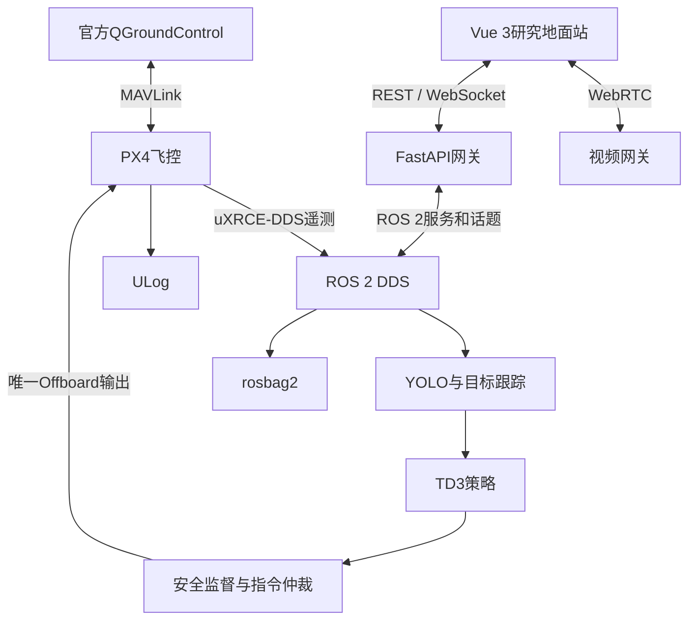

# PX4双地面站系统方案设计

## 1. 建设目标

面向“基于视觉感知的无人机识别与自主追踪”课题，建设一套能够连接PX4 SITL和实机的研究地面站，支持遥测、视觉、目标跟踪、TD3策略、任务控制、实验记录与安全降级。

系统不重复实现QGroundControl成熟的配置功能：

- 官方QGC负责固件、校准、参数、任务检查和人工接管；
- Web地面站负责科研算法、实验流程、可视化和高层任务请求；
- PX4仍负责姿态控制、位置控制和固件级失效保护；
- ROS 2负责感知、规划、Offboard控制和地面侧安全监督。

## 2. 总体架构



## 3. 控制面边界

| 模块 | 允许操作 | 禁止操作 |
|---|---|---|
| 浏览器 | 连接、解锁请求、起飞任务、追踪任务、悬停、降落、急停 | 直接发送PWM、姿态或连续setpoint |
| FastAPI | 鉴权、幂等、命令转发、遥测聚合、审计 | 运行高频控制闭环 |
| ROS 2安全节点 | 前置检查、限幅、超时保护、控制权仲裁 | 绕过PX4保护逻辑 |
| PX4 | 姿态/位置控制、解锁检查、固件failsafe | 依赖浏览器维持安全 |
| QGC/遥控器 | 配置、人工控制、接管 | 与ROS 2同时持续发送Offboard指令 |

系统中只有ROS 2安全仲裁节点可以向PX4发布研究算法产生的Offboard setpoint。FastAPI和MAVSDK只用于遥测、高层动作或任务管理，不建立第二条竞争控制链。

## 4. 软件模块

```text
ground_station/
├── web/                 # 飞行总览、位置、姿态、控制和告警
├── api/                 # REST、WebSocket、命令幂等和适配器
├── ros2_ws/src/
│   ├── uav_interfaces/  # 公共消息与服务
│   ├── px4_adapter/     # PX4 uXRCE-DDS适配
│   ├── uav_safety/      # 状态机、限幅、看门狗和控制权仲裁
│   ├── uav_perception/  # 后续：YOLO与视觉预处理
│   ├── uav_tracking/    # 后续：跟踪器与TD3策略
│   └── uav_experiment/  # 后续：rosbag与指标
└── config/              # 安全阈值和实验配置
```

GAAS不作为直接运行依赖，而是参考其“感知—定位—规划—控制”模块化思想，在ROS 2和当前PX4接口上重新实现适配层。

## 5. 接口基线

### Web与FastAPI

| 接口 | 用途 |
|---|---|
| `GET /api/v1/health` | 服务与适配器状态 |
| `GET /api/v1/vehicles/primary/telemetry` | 当前遥测快照 |
| `POST /api/v1/commands` | 提交带唯一ID的高层命令 |
| `WS /api/v1/ws/telemetry` | 10 Hz遥测和告警 |

### ROS 2

| 接口 | 用途 |
|---|---|
| `/fmu/out/*` | PX4通过uXRCE-DDS输出的飞行数据 |
| `/uav/px4_status` | 适配后的只读PX4状态 |
| `/uav/safety_status` | 安全状态和当前控制源 |
| `/uav/submit_command` | 高层命令验证服务 |
| `/fmu/in/offboard_control_mode` | 后续Offboard心跳，仅由安全节点发布 |
| `/fmu/in/trajectory_setpoint` | 后续安全限幅后的setpoint |

## 6. 数据与视频

- 浏览器视频采用WebRTC；
- 机载相机通过GStreamer/RTSP进入视频网关；
- 检测框、目标ID和置信度走WebSocket元数据并在前端Canvas叠加；
- 高频ROS话题保存到rosbag2；
- 飞控原始日志保存为PX4 ULog；
- 用户、模型、实验和操作审计进入PostgreSQL或MySQL；
- 每次实验记录代码Commit、配置快照、模型SHA256、rosbag、ULog和指标结果。

## 7. 部署模式

### 开发模式

macOS或Windows可以运行Vue和FastAPI模拟适配器，用于界面与接口开发；PX4 SITL、ROS 2和算法节点在Ubuntu主机运行。

### SITL模式

QGC、PX4 SITL、Micro XRCE-DDS Agent、ROS 2节点和Web服务运行在同一局域网。完成自动化状态转换、断链、低电和目标丢失测试后才能进入实机阶段。

### 实机模式

伴随计算机运行ROS 2感知与控制闭环，地面计算机运行QGC和Web服务。网络断开时，PX4与机载安全逻辑必须能够独立悬停、返航或降落。

## 8. 基础版本完成边界

当前代码完成：

- Vue 3实时仪表盘；
- FastAPI健康检查、遥测、命令和WebSocket；
- 模拟PX4状态与遥测；
- 命令幂等和基础安全状态机；
- ROS 2接口、安全节点及只读PX4状态适配器骨架；
- Docker与本地启动入口。

当前明确未完成：

- PX4实际解锁、起飞与Offboard写入；
- FastAPI和ROS 2的生产级桥接；
- QGC/遥控器/自主控制的控制权仲裁；
- YOLO、TD3、视频、地图、数据库和实验回放；
- 实机安全认证与阈值标定。
